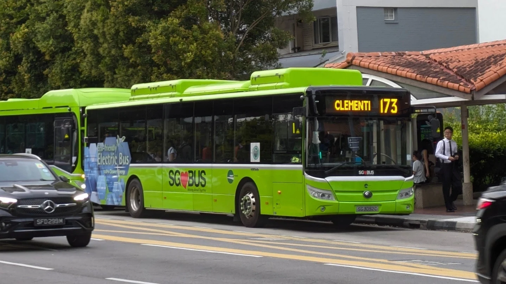
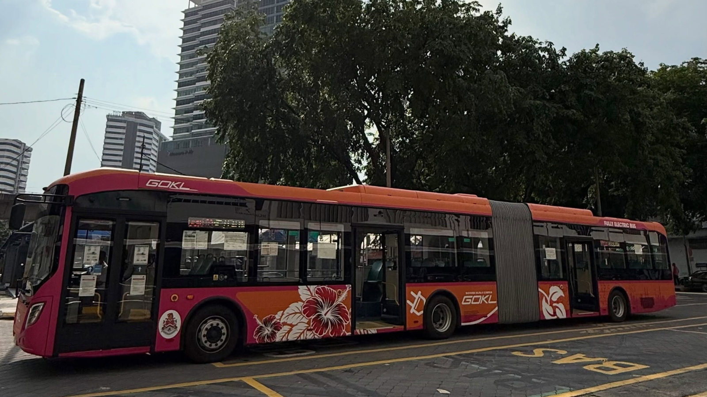

<<<<<<< HEAD

# Hi there, I'm Clement Chong 👋

- 🎓 **Software Engineering Undergraduate** at Sunway University (in partnership with Lancaster University)
- 🏆 **Top 150 Builder** @ OpenAI Build Week: Codex Community Hackathon Kuala Lumpur 2026
- 🏅 **4x Dean’s List Awardee** (CGPA: 3.56 / 4.00)
- 💼 **Seeking a Software Engineering Internship** starting **25 January 2027** *(Open to Subang Jaya, PJ & KL)*
=======
## GitHub Stats

<table><tbody><tr border="none"><td width="50%" align="center">

>>>>>>> parent of 5479e87 (Update README.md)

## Hello there

<<<<<<< HEAD
## 🚀 Featured Projects

| Project                                                           | Description                                                                                     | Stack & Traction                                                    |
| :------------------------------------------------------------------ | :------------------------------------------------------------------------------------------------ | :-------------------------------------------------------------------- |
| 🍲 **[WarungAI](https://github.com/clemedev/WarungAI)**           | Mobile-first bookkeeping PWA for Malaysian hawkers with receipt OCR & hands-free voice logging. | React, Supabase, PostgreSQL, Vercel • *Top 150 Builder (Codex KL)* |
| 📄 **[Scribd-Viewer](https://github.com/clemedev/Scribd-Viewer)** | Open-source web tool generating embedded document previews without paywall redirects.           | Python, JavaScript, GitHub Pages • *30+ ⭐ • ~100 weekly visits*  |
| 🤖 **[AiChat](https://github.com/clemedev/AiChat)**               | Command-line developer assistant integrating the Google Gemini API for fast shell answers.      | Python, Google Gemini API, CLI                                      |
| 📇 **[DName](https://clemedev.github.io/DName/)**                 | Minimalist, responsive digital name card with traffic analytics.                                | HTML5, CSS3, JavaScript, Google Analytics                           |
=======
Welcome to my GitHub Profile, I love Metro systems. feel free to check out my projects in my profile! You can reach out to me via my [Digital Name Card](https://clemedev.github.io/DName/)

>>>>>>> parent of 5479e87 (Update README.md)

> Singapore Bus Service 173 - connecting Bukit Batok Interchange to Clementi Interchange - Yutong E12 Electric Bus

<<<<<<< HEAD
## 🛠️ Tech Stack & Tools

- **Core Languages:** Python, HTML5, CSS3
- **Developer Tools & Platforms:** Git, GitHub, Linux CLI, Vercel, Google Gemini API
- **Coursework & AI-Assisted Prototyping:** JavaScript, React, SQL (PostgreSQL), Supabase, Java, Scala

---

## 📊 GitHub Highlights

- 🌟 **30+ Stars & 4 Forks** earned on open-source repositories
- 📈 **370+ Contributions** in the past year
- 🌍 Tools used organically by students across Vietnam, India, Pakistan, and Latin America

---

## 📬 Let's Connect!

- 💼 **LinkedIn:** [linkedin.com/in/clementtech](https://www.linkedin.com/in/clementtech/)
- 📇 **Digital Card:** [clemedev.github.io/DName](https://clemedev.github.io/DName/)
- ✉️ **Email:** [clementch730@gmail.com](mailto:clementch730@gmail.com)
=======

> Malaysia's First Articulated Bus Fleet from GOKL - CRRC C18 Electric Bendy Bus
>>>>>>> parent of 5479e87 (Update README.md)
